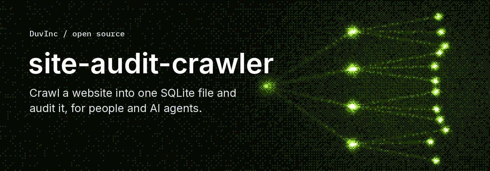

# site-audit-crawler



**You want to know everything that is technically wrong with a website, and you want an AI agent to be able to read the answer.** This crawls the site into one SQLite file, runs about 150 technical, SEO and AI-readiness controls on it, joins your Google Search Console data by URL, and writes a summary for agents and a report for people.

```bash
git clone https://github.com/DuvInc/site-audit-crawler && cd site-audit-crawler && npm install
node bin/site-audit.mjs run https://example.com
# 806 URLs in 17 s -> audits/example.com/2026-11-18
# 38 controls with findings out of 121 run, 1744 findings -> report.md, summary.json
node bin/site-audit.mjs run https://example.com --gsc treg --ai --budget 0.10
# ...joins Search Console, asks two small models, and reports 56 controls with findings out of 152
```

Measured on two real sites in November 2026: **lookio.app** (a SaaS site with its docs, 806 URLs) crawled in 17 s, **gduv.club** (a personal site in four languages, 822 URLs) in 19 s, on a laptop, for $0. The optional AI layer cost **$0.059 for 250 pages** and $0.028 for 179, and a re-run on unchanged pages costs nothing. An example report on a small site with planted defects: [examples/report.md](examples/report.md).

## What it finds

| Area | Examples of controls |
| --- | --- |
| Response codes | broken internal and external links with the page and anchor that point at them, redirect chains and loops, temporary redirects, pages blocked by robots.txt |
| Indexability | noindex, canonicalised pages, canonicals to non-indexable URLs, sitemap URLs that are not indexable, orphans |
| On-page | missing, duplicate or templated titles and descriptions, H1 and heading order, a past year in a title, Open Graph and X cards |
| Content | exact and near duplicates (simhash), placeholder text, thin pages, soft 404s |
| Internal links | depth, inlinks, a link score (PageRank on internal links), pages with fewer than 5 linking pages, no link from content, all anchors identical, generic anchors |
| International | hreflang return links, codes, self references, x-default, mismatch with `<html lang>` |
| Structured data | parse errors, required fields of Article, BreadcrumbList, FAQPage, Product, `WebSite` on the home page |
| Speed and weight | HTML heavier than 90 % of the web, DOM over 1,400 nodes, TTFB, images over 100 kB or in PNG/JPEG, LCP image lazy-loaded |
| JavaScript | content, links, titles and canonicals that only exist after rendering (AI crawlers do not render), JS errors, axe-core accessibility, lab LCP and CLS |
| AI readiness | AI crawlers blocked in robots.txt, a GPTBot user-agent refused, `nosnippet` (which keeps a page out of AI Overviews), `llms.txt`, Markdown versions, articles without sources or figures |
| Search Console | pages on page 1 with a click rate far under the usual one, pages at position 4 to 20 sorted by clicks to gain, URLs Google shows that now fail, a canonical Google did not keep, indexable pages Google has not indexed, one query split between two of your pages |
| AI judgments (optional) | a taxonomy of page types and topics, titles and descriptions that do not describe the page, openings that do not get to the point, two pages that target the same search, internal links to add with the anchor already in the text |

Every threshold has its source, or is marked as a convention: [docs/thresholds.md](docs/thresholds.md). Google's own documentation comes first, then web.dev, the HTTP Archive Web Almanac, one peer-reviewed paper, Pew Research, and a few industry studies, labelled as such.

## How it works

```
                      robots.txt, sitemaps
                              |
  site-audit crawl  --->  crawl.db  <---  render   one page per template in Chrome
   (fetch, cheerio)    pages, links,  <---  gsc      Search Console: your API access, or treg
                       texts, sitemaps <---  ai      OpenRouter: decision model + chat model, cached
                              |
                     site-audit analyze  --->  issues table, summary.json, report.md
```

- **One SQLite file per crawl, not an interface.** `pages` has one row per URL and 72 columns, `links` one row per link with its anchor, `rel` and position (nav, header, footer, content). Most controls are a single SQL query on these tables (`lib/analyze.mjs`), so adding one is adding one line, and an agent can ask its own questions in SQL.
- **Internal URLs are fetched one redirect hop at a time**, so a chain is seen as a chain. External URLs are only checked (HEAD, then GET when HEAD is refused).
- **The code picks the candidates, the models only judge.** Two pages are compared for cannibalisation only when their target queries share most of their words; a link is proposed only where the target's subject already appears, word for word, in the source page. The judgment is a probability from a decision model, not prose from a chat model: cheaper, and a threshold you can move afterwards without paying again.
- **Search Console totals are read without dimension.** Google drops rare queries from any request split by query, or by page and country; in the author's measurements that hid 30 to 60 % of the clicks. The site total is the only number that is not trimmed; the per-page and per-query tables are for ranking, not for totals.

## Try it locally

Node 22.13 or newer.

```bash
git clone https://github.com/DuvInc/site-audit-crawler
cd site-audit-crawler
npm install
cp .env.example .env        # only for Search Console and the AI layer
node bin/site-audit.mjs run https://your-site.example
```

Or without cloning anything: `npx github:DuvInc/site-audit-crawler run https://your-site.example`.

Without any key or account, you get the crawl, every control that does not need Search Console or a model, and the JavaScript rendering if Google Chrome is installed (or `CHROME_PATH` points at a Chrome or Chromium binary). Results land in `audits/<host>/<date>/`:

| File | For |
| --- | --- |
| `summary.json` | an agent: every control with its count and five examples, sections, link scores, Search Console, AI tables |
| `report.md` | a person |
| `crawl.db` | everyone: the raw data, `sqlite3 crawl.db` |

Each step also runs alone: `crawl`, `analyze`, `render`, `gsc`, `ai`, `compare`. `node bin/site-audit.mjs --help` lists the options (URL budget, concurrency, include and exclude patterns, user-agent, sample size, Search Console window, AI budget and models).

## Search Console

Two ways to give the tool read access. Both read the same data.

**Your own Google API access.** Set up access to the Search Console API by following [Google's guide](https://developers.google.com/webmaster-tools), then point `GOOGLE_APPLICATION_CREDENTIALS` at a service account key (added as a user of the property) or set `GSC_ACCESS_TOKEN`, and run with `--gsc google`.

**Or treg.** [treg](https://treg.to/?ref=guillaumeduv-sd2vs) is a catalog of APIs with a CLI. You connect your Google account once in the browser, and the tool calls Search Console through it: no Google Cloud project, no key file on your disk.

```bash
treg connections connect --provider google-search-console
node bin/site-audit.mjs run https://your-site.example --gsc treg
```

The treg link above is a referral link: the author may be rewarded if you sign up through it. The tool works the same with your own Google access.

The property is found among the ones your account can read (`sc-domain:` first, then URL-prefix properties), or set it with `--property`. The window is the last 90 days, ending three days back because Google's final data lags. URL inspection runs on the 40 best-linked indexable pages that had no impression (`--inspect`; Google allows 2,000 a day per property).

## The AI layer

Optional, paid, capped. It needs an [OpenRouter](https://openrouter.ai) key in `OPENROUTER_API_KEY`.

**`--budget` is a hard cap in dollars for the run (default 0.50).** Before each call, the tool reserves that call's worst case at the listed price (input counted generously, output at its maximum) and sends it only if everything already spent, plus every call in flight, plus this one, still fits. On lookio.app the worst case reserved was 2 to 10 times the real cost, so a full run stays well under it. `--dry` prints the worst case of a run without sending anything. A key credit limit in OpenRouter's settings is still a good second fence.

| Step | Model | What it does |
| --- | --- | --- |
| `taxonomy` | chat, 1 call | reads every title and writes the site's page types and topics |
| `pages` | decision, 1 call per page | page type, topic, search intent; is the title faithful, the description, does the opening get to the point, is the page thin, is it an error page |
| `queries` | chat, 1 call per page | the search query the page is built for, and a one-line summary |
| `cannibal` | decision, one page and its candidates per call | do two pages with close target queries answer the same search? |
| `links` | decision, one target and its passages per call | would linking this phrase, already in the text, to that page help the reader? |

Defaults: `typesafe/jev-1.13` as the decision model (input billed, output free, through OpenRouter's Decisions API, still in alpha) and `openai/gpt-6-luna` as the chat model with reasoning off, on OpenRouter's **Flex tier**: the same model at about half the price, answering in about 15 s instead of 2 because it runs on spare capacity; when Flex has none, the call goes to the normal tier. `--chat-tier normal` skips Flex. Both can be changed (`--decision-model`, `--chat-model`). Every answer is cached by a hash of the exact request in `audits/<host>/ai-cache.db`; `--dry` shows the requests without sending them, `--pilot 5` sends five pages, and `--ai-include` / `--ai-exclude` (regular expressions on the URL) choose which pages the models see: on a large site, one language and the editorial pages are usually enough.

**What it cost, measured** (OpenRouter's reported cost per call, November 2026, chat steps on the normal tier; Flex halves the taxonomy and queries columns):

| Site | Pages | taxonomy | pages | queries | cannibal | links | Total |
| --- | --- | --- | --- | --- | --- | --- | --- |
| lookio.app | 250 | $0.0011 | $0.0222 | $0.0163 | $0.0037 | $0.0152 | **$0.059** |
| gduv.club | 179 | $0.0009 | $0.0139 | $0.0121 | $0.0006 | $0 | **$0.028** |
| either, second run | | | | | | | **$0** |

**What the answers are worth**, read by hand on lookio.app, not measured on a labelled set: the two cannibalisation pairs above 0.75 were right, 0.5 to 0.75 is worth reading, below 0.2 nothing (275 pairs out of 333). Of eight link proposals above 0.8 drawn at random, five were clearly good, two debatable, one wrong. The seven descriptions scored under 0.3 were all hollow, but the model let 63 templated descriptions through that a plain rule catches. Read the proposals before applying them.

## Using it with an AI agent

[skills/site-audit/SKILL.md](skills/site-audit/SKILL.md) is the procedure for an agent: run, read `summary.json`, dig with SQL, check before claiming. A few queries it relies on:

```sql
-- every link to a broken URL, with the page and the anchor
SELECT l.src, l.anchor, l.position, p.status FROM links l JOIN pages p ON p.url = l.dst
WHERE p.status >= 400 AND l.type = 'hyperlink';

-- the pages Google shows most that internal links serve least
SELECT g.url, g.impressions, round(g.position, 1) AS position, p.link_score, p.unique_inlinks
FROM gsc_pages g JOIN pages p USING (url) WHERE p.indexable = 1 ORDER BY g.impressions DESC LIMIT 20;

-- one control, every URL
SELECT url, detail FROM issues WHERE code = 'redirect_chain';
```

## Using it from code

```js
import { crawl, analyze, importSearchConsole, tregTransport, runAi, openRouterClient } from './lib/index.mjs';

const dir = 'audits/example.com/today';
await crawl({ start: 'https://example.com', dir, max: 2000 });
analyze(dir);
await importSearchConsole(dir, { transport: tregTransport(), source: 'treg' });
await runAi(dir, { client: openRouterClient({ apiKey: process.env.OPENROUTER_API_KEY }), budget: 0.1 });
const summary = analyze(dir);
summary.issues[0]; // { code, category, priority, kind, label, urls, examples: [{ url, detail }] }
```

The library never reads the environment. The three things that talk to an outside service are injected: `fetch` for the crawl, a Search Console transport (`lib/google.mjs` or `lib/treg.mjs`, or yours: `(path, body?) => Promise<json>`), and a model client (`lib/openrouter.mjs`, or yours with `decide(body)` and `chat({ model, system, user, schema })`). That is how the tests run with no network beyond localhost and no key.

## What this is not

- **Not a rank tracker or a backlink tool.** It reads your site and your Search Console, nothing about other sites.
- **Not a large-site crawler yet.** It keeps its queue in memory and has been run on sites of about 800 URLs. Use `--max` and `--include` on large sites.
- **Not a way through bot protection.** It sends a clear user-agent, respects robots.txt, and does not try to pass a WAF or a captcha. Crawl sites you are allowed to crawl.
- **Not real-user performance.** LCP and CLS come from one load in a local Chrome. For field data, look at the Chrome UX Report.
- **Not a verdict.** The AI scores are probabilities with thresholds set by reading samples. The findings are leads to check, with the query that produced each one.

## Credits

[cheerio](https://cheerio.js.org) parses the HTML. [playwright-core](https://playwright.dev) drives Chrome and [axe-core](https://github.com/dequelabs/axe-core) checks accessibility, both loaded only by the render step. [OpenRouter](https://openrouter.ai) serves the models; [Jev](https://openrouter.ai/typesafe/jev-1.13) by typesafe is the default decision model. The thresholds lean on Google Search Central, web.dev, the HTTP Archive Web Almanac, the GEO paper (Aggarwal et al., KDD 2024) and Pew Research, all linked in [docs/thresholds.md](docs/thresholds.md).

MIT licence. Contributions: [CONTRIBUTING.md](CONTRIBUTING.md). Working on the code with an agent: [AGENTS.md](AGENTS.md).
